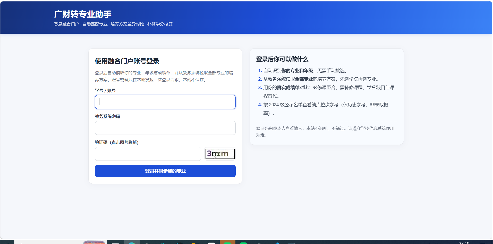
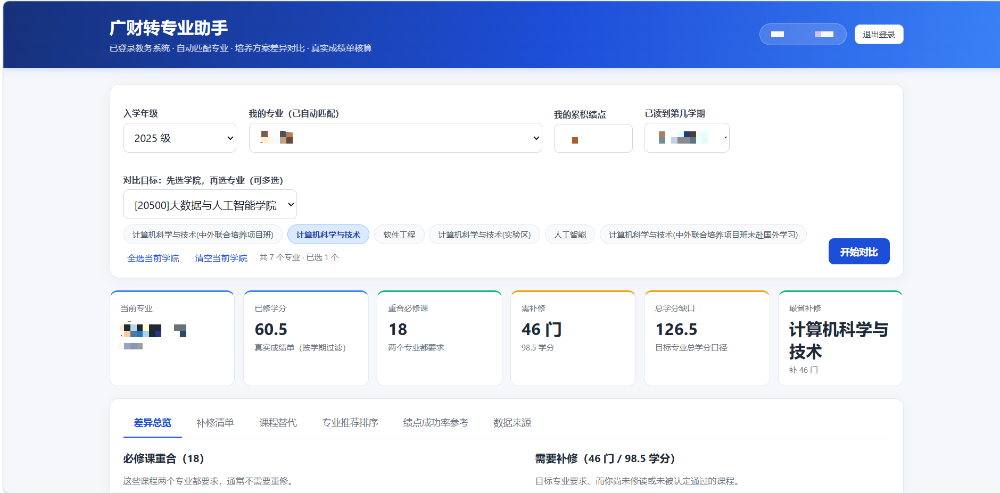
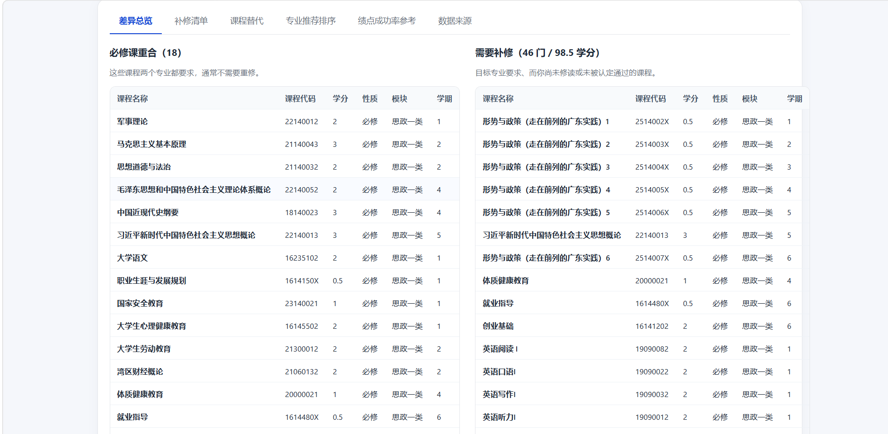
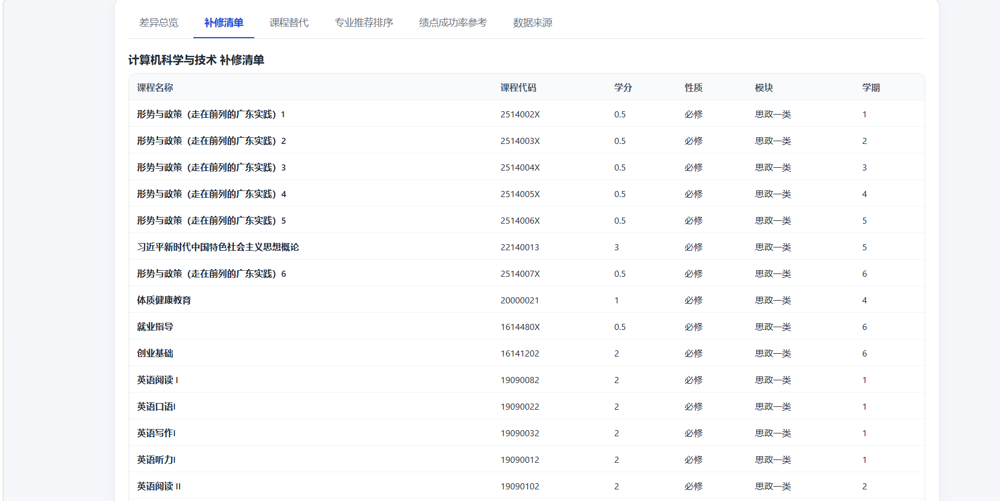
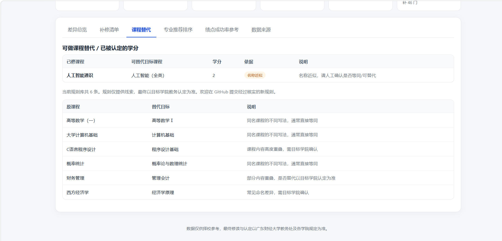
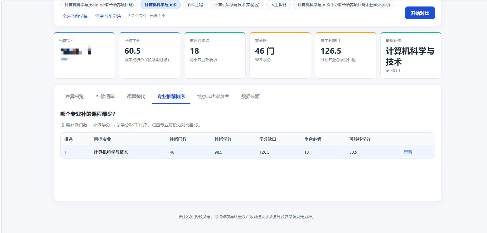
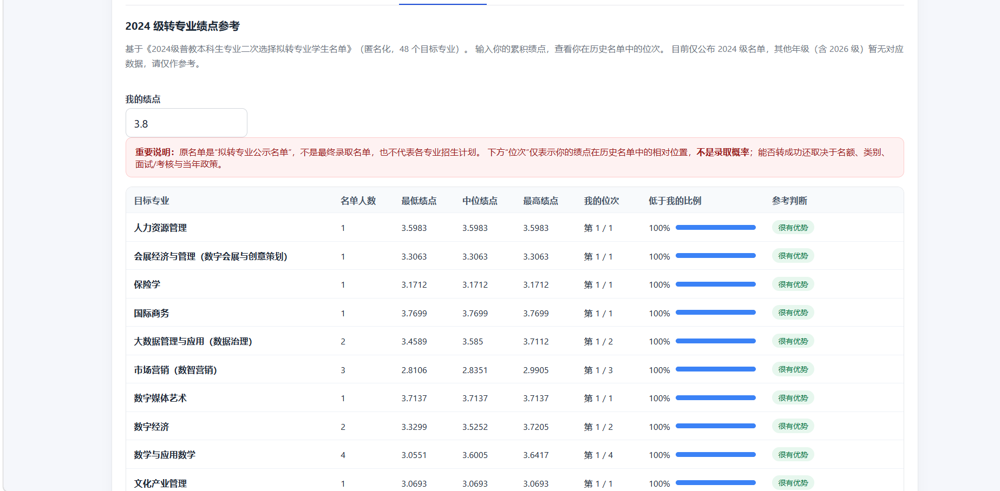

# 广财转专业助手

一个面向广东财经大学学生的转专业决策工具。**登录融合门户后自动匹配你的专业和年级**，从教务系统读取真实成绩单和全部专业的培养方案，查看差异、补修学分、课程替代和「转哪个专业最省课」排序；再用 2024 级转专业公示名单做绩点位次参考。验证码由你本人查看输入，本站不识别、不绕过、不保存密码。

> ⚠️ **请先读[隐私与合规](#隐私与合规)一节。** 本项目不包含、也不应包含任何绕过学校验证码或批量抓取的能力。学号、密码和验证码均由本人输入；前端不保存密码，中继只转发请求。

## 在线使用

直接双击 **启动广财转专业助手.bat**

这是已部署的公网版本，不用装环境。链接里已带访问分享码；电脑端中继不在线时，登录会提示中继未连接（见[手机访问与电脑中继](#手机访问与电脑中继)）。

## 功能

- **融合门户登录 + 自动匹配**：登录后自动识别你的专业、年级并读取真实成绩单；专业列表来自教务系统的全部专业，不再局限于示例数据。
- **先选学院、后选专业**：目标专业按教务系统筛选项分组，可全选/清空某个学院，快速锁定想去的专业。
- **培养方案对比**：现专业 vs 目标专业的必修课重合、已满足课程、需补修课程清单。
- **学分核算**：补修学分、可转移学分、目标专业总学分缺口（两个口径分别展示）。
- **课程替代**：按课程代码、课程名、社区维护的替代规则匹配，近似匹配会明确标为「需人工确认」。
- **专业排序**：按补修门数、补修学分、学分缺口排序，快速找到成本最低的目标专业。
- **绩点成功率参考**：基于 2024 级拟转专业公示名单（256 条匿名记录、48 个目标专业），输入绩点即可查看名单内位次、最低/中位/最高绩点与参考判断；明确标注不是录取概率。
- **已修学期可调**：从第 1 到第 8 学期末任选，按当前专业与就读学期推算已修课程。

培养方案抓取按表头识别列、并把专业/年级下拉解析为选项 value 提交；若学校页面结构变化导致解析失败，欢迎把**脱敏**的页面 HTML 提交 issue，我们来改进解析器。

## 界面预览

| 登录融合门户 | 对比总览（真实成绩单） |
|---|---|
|  |  |

| 差异总览 | 补修清单 |
|---|---|
|  |  |

| 课程替代 | 专业推荐排序 |
|---|---|
|  |  |



## 技术栈

| 层 | 技术 | 说明 |
|---|---|---|
| 前端 | React 18 + TypeScript + Vite | 浅色主题，响应式布局 |
| 后端 | Python 3.10+ / FastAPI | 会话代理、解析、对比引擎 |
| 解析 | requests + BeautifulSoup4 | 按表头识别列，兼容 GBK/UTF-8 混编 |
| 存储 | 内存会话 + 本地会话文件 | 会话文件只存 Cookie 与档案，不含密码，且已 gitignore；未登录档案在浏览器 localStorage |

关键实现位于：

- `backend/app/jwxt.py` — 教务系统适配器（验证码 / 登录 / 成绩 / 培养方案）
- `backend/app/comparator.py` — 对比与替代算法
- `backend/app/main.py` — API 路由与会话管理
- `backend/data/substitution_rules.json` — 课程替代规则库
- `backend/data/transfer_gpa_2024.json` — 2024 级转专业绩点统计（已匿名化）
- `backend/tools/generate_demo_data.py` — 演示数据生成器
- `backend/tools/parse_transfer_pdf.py` — 将公示名单 PDF 表格转成匿名统计数据的脚本

使用的教务系统接口（湖南强智 jsxsd，GDUFE 实例）：

| 用途 | 路径 |
|---|---|
| 验证码 | `/jsxsd/verifycode.servlet` |
| LDAP 登录 | `/jsxsd/xk/LoginToXkLdap` |
| 学籍卡片 | `/jsxsd/grxx/xsxx` |
| 成绩单 | `/jsxsd/kscj/cjcx_list` |
| 培养方案筛选页 | `/jsxsd/jspyfa/pyfa_find` |
| 培养方案真实查询 | `/jsxsd/jspyfa/zypyfa_query` |
| 本人培养方案（执行计划） | `/jsxsd/pyfa/pyfa_query` |

## 本地运行

双击项目根目录的 `启动广财转专业助手.bat`，会自动启动服务并打开 http://127.0.0.1:8000 。打包版（含 `.venv` 与 `backend/web`）双击即用、断网也能开；直接 clone 源码的话，首次运行会自动安装后端依赖，前端需要先按下面的命令构建。下面的命令也可以手动运行。

```bash
# 后端
cd backend
python -m venv .venv
source .venv/bin/activate          # Windows: .venv\Scripts\activate
pip install -r requirements.txt
uvicorn app.main:app --reload --host 127.0.0.1 --port 8000

# 前端（另开一个终端）
cd frontend
npm install
npm run dev
```

浏览器打开 http://127.0.0.1:8000 。这一步要先执行 `npm install`，且上面的后端进程需保持运行；只用于本机开发。想直接使用请打开上面的[在线地址](#在线使用)。前端已配置 `/api` 代理到后端 8000 端口。

后端 API 文档：http://127.0.0.1:8000/docs

## 数据来源与准确性

1. `demo_programs.json` 是**公共方案库的示例内容**，不是官方培养方案，页面上有明确提示。方案按年级维护，由 `generate_demo_data.py` 生成，每次运行覆盖当前年份及前 5 年（当前为 2021–2026 级）；请勿据此做实际决策，欢迎贡献真实方案替换它。
2. 后端保留的教务系统适配器按「课程名称」「学分」等表头识别列，而不是固定列号，便于社区后续接入真实数据。系统页面结构可能因版本/年级不同而变化，欢迎把新结构的脱敏 HTML 样本和解析改进提交为 PR。
3. 课程替代涉及学院认定规则。规则库中的条目只是线索，标为「名称近似」的匹配**必须人工确认**，最终解释权归教务处与相关学院。
4. 「可转移学分」采用保守口径：只计入匹配目标专业要求的课程，以及已修的通识选修课；原专业中未被目标方案要求的课程是否计入自由选修学分，由学院认定，工具不作假设。
5. 「已修课程」按你选择的专业和就读学期推算，用于估算差异，不代表你的真实成绩单；最终需以个人实际已修课程为准。
6. 绩点数据来自《2024级普教本科生专业二次选择拟转专业学生名单》，**仅适用于 2024 级的历史参考**（其他年级包括 2026 级暂无对应名单）。原名单为**拟转专业公示名单**，不是最终录取名单；「位次」只是历史参考，不代表录取概率，不构成立即转专业成功的承诺。数据已去除姓名与完整学号后才入库。

## 手机访问与电脑中继

公网发布环境无法直接访问校园网内的 `jwxt.gdufe.edu.cn`，因此手机登录需要由你自己的电脑做一次中转。电脑保持开机、联网，并运行以下两个进程：

```bash
# 终端 1：本地后端（真正访问教务系统）
python -m uvicorn app.main:app --app-dir backend --host 127.0.0.1 --port 8000

# 终端 2：中继代理（把公网 API 请求转给上面的本地后端）
python backend/tools/relay_agent.py
```

中继代理不再内置公网地址、分享码或密钥。运行前必须设置环境变量 `RELAY_PUBLIC_URL`、`RELAY_SHARE_CODE`、`RELAY_SECRET`（随机长字符串），可选 `RELAY_LOCAL_URL`、`RELAY_AGENT_ID`；公网页端启动时需要 `RELAY_MODE=public` 以及相同的 `RELAY_SECRET` / `RELAY_AGENT_ID`。两端不一致会直接拒绝注册。密码和会话 Cookie 只在内网本地后端处理，中继不落盘保存。电脑或中继离线时，公网页面的登录会提示中继未连接。

单端口部署（页面和 `/api` 同源）时：先执行 `cd frontend && npm run build`，再把 `frontend/dist/` 的内容复制到 `backend/web/`，启动后端即可。`backend/web/` 是构建产物，已 gitignore。

## 隐私与合规

- 密码只在登录时用于一次教务系统请求，不落盘、不打印日志、不随 API 返回。登录会话保存在内存，并会持久化到本地文件以便重启后保持登录；文件只包含 Cookie 与档案，不含密码，且已 gitignore，30 分钟过期。未登录时的年级/绩点档案只存在你自己的浏览器 localStorage。
- 转专业绩点数据已匿名化，不包含姓名与完整学号。公开发布前请再次确认数据符合学校公示与个人信息保护要求。
- 验证码由用户本人查看并输入，本项目不做 OCR、不提供自动打码接口。
- 请遵守《广东财经大学学生手册》及学校信息系统使用规定，以合理频率使用，不要用于批量爬取、抢课、账号共享或任何自动化绕过。
- 建议使用 `HTTPS + 反向代理` 部署；不要把测试账号密码提交到仓库或 issue。
- 本项目与广东财经大学官方无关，不提供任何录取、转专业资格或学分认定承诺。

## 贡献

- 发现解析失败：请附上**脱敏**的 HTML 片段（去掉姓名、学号）开 issue。
- 新增替代规则：编辑 `backend/data/substitution_rules.json`，注明来源与适用范围，附学院文件链接或说明。
- 补充真实培养方案：参考 `backend/data/demo_programs.json` 的结构提交结构化 JSON，并注明年级、学院与来源链接。
- 提交前运行：`python -m compileall backend/app` 与 `npm run build`。

## License

MIT — 见 [LICENSE](LICENSE)。
